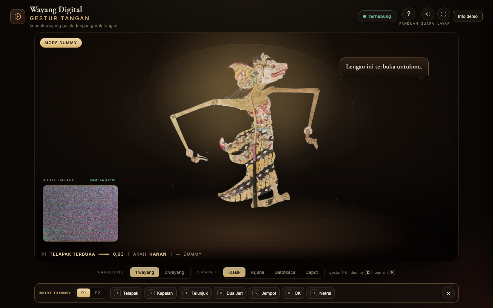
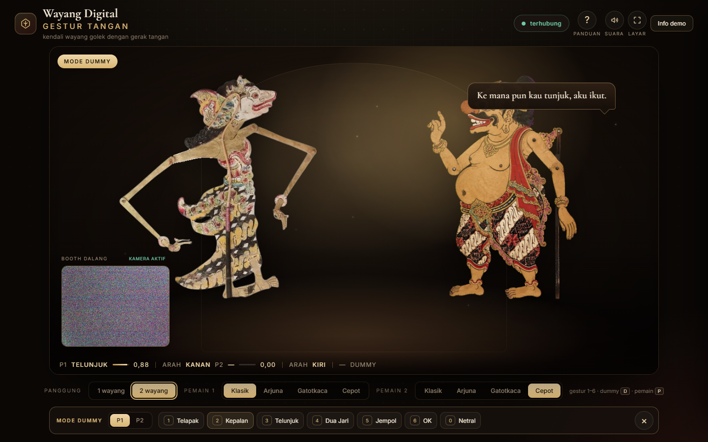
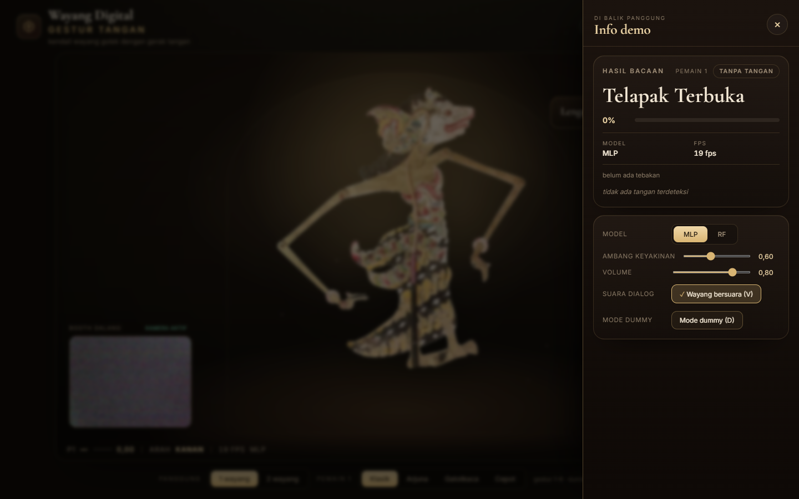
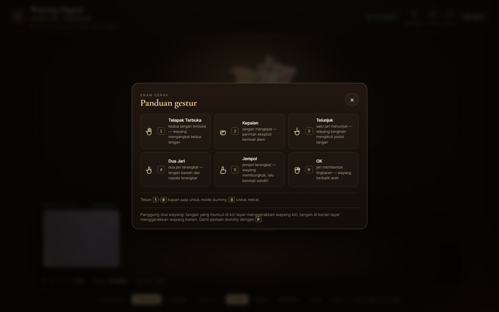

# Wayang Digital Gestur Tangan

Aplikasi demo satu layar: webcam dibaca backend, gestur tangan ditebak model P2,
lalu wayang golek SVG di halaman bergerak mengikuti gestur. Panggungnya hidup:
tirai, sorot lampu, balon dialog, dan empat babak kecil (pembuka → live → jeda
→ tidur) mengikuti kehadiran tangan.

Dokumen rancangan: `Rancangan_Backend_Frontend_Wayang_v0.1.md`.
Kerangka fitur mengikuti Bab 3–5 dokumen itu. Alur panggung hidup mengikuti
`docs/superpowers/specs/2026-10-21-panggung-hidup-design.md` dan rencana
`docs/superpowers/plans/2026-10-21-panggung-hidup.md`.

---

## Tampilan

Panggung hidup: satu wayang, balon gestur, strip kaki pembacaan, dan bar mode
dummy di bawah (diambil lewat `D` + tombol gestur).



Panggung dua wayang — tangan kiri layar menggerakkan wayang kiri, tangan kanan
menggerakkan wayang kanan; pilihan pemain per sisi ada di bawah panggung.



Laci "Info demo" di kanan: hasil bacaan, top-3, pemilih model, ambang
keyakinan, volume, dan sakelar suara dialog wayang.



Panduan enam gestur (`?`), lengkap dengan glif tangan dan nomor tombolnya.



Keempat tangkapan layar diambil pada 1440×900 di Chrome dengan backend
berjalan; gambar inset kamera pada dua tangkapan pertama sedang buram karena
webcam mesin ini mengirim derau, bukan karena aplikasi.

---

## 1. Menjalankan

Prasyarat di semua sistem: **Python 3.10–3.12** (MediaPipe tidak punya wheel di
luar rentang itu) dan jaringan untuk unduh paket. Backend yang memegang kamera,
browser hanya menampilkan — jadi backend harus hidup.

### Windows

Dua skrip siap pakai: `setup.bat` (sekali saja: bikin `.venv`, pasang
`requirements.txt`, pastikan model pelacak tangan ada) lalu `run.bat` (setiap
kali mau demo).

| Shell | Setup sekali | Setiap kali demo |
| --- | --- | --- |
| Explorer | double-click `setup.bat` | double-click `run.bat` |
| **CMD** (`cmd.exe`) | `setup.bat` | `run.bat` |
| **PowerShell** | `.\setup.bat` | `.\run.bat` |
| **Windows Terminal** | ikut shell yang aktif di tab (lihat dua baris di atas) | sama |

> PowerShell **sengaja** tidak menjalankan berkas dari folder saat ini tanpa
> path, jadi `run.bat` polos melempar
> *"The term 'run.bat' is not recognized"*. Pakai `.\run.bat`, atau
> `cmd /c run.bat` kalau tidak mau menambah `.\`. Ini bukan error aplikasi.

Tanpa skrip (CMD maupun PowerShell, dari folder proyek):

```bat
python -m venv .venv
.venv\Scripts\activate
python -m pip install -r requirements.txt
python backend\tools\download_hand_model.py
python -m backend.app
```

### Linux & macOS

`setup.bat` / `run.bat` tidak jalan di luar Windows. Ketik setaraannya dari
folder proyek (di `bash` atau `zsh`):

```bash
python3 -m venv .venv
source .venv/bin/activate          # macOS/Linux
pip install -r requirements.txt
python backend/tools/download_hand_model.py
python -m backend.app
```

Perlu dicatat jujur untuk non-Windows: jalur kamera di mesin ini diuji dengan
webcam laptop Windows, jadi dua hal berikut belum terverifikasi di sistem lain.

- **Linux:** OpenCV membaca webcam lewat V4L2. Kalau `/video_feed` kosong atau
  `camera: false` di `/api/health`, cek hak akses `/dev/video0`
  (`sudo usermod -aG video $USER`, lalu login ulang) dan pastikan webcam tidak
  dipakai aplikasi lain.
- **macOS:** Python perlu izin kamera (System Settings → Privacy & Security →
  Camera). Izin ini diminta per aplikasi, jadi beri izin ke Terminal/iTerm
  tempat `python -m backend.app` dijalankan, bukan ke browser.

### Semua sistem

Buka <http://127.0.0.1:8000> setelah backend hidup. Model P2
(`models/model_mlp.pkl`) dan rig wayang (`frontend/assets/wayang.svg`) sudah
ikut di repo, jadi tidak ada unduhan model gestur tambahan. Host/port bisa
diubah lewat `WAYANG_HOST` / `WAYANG_PORT` (dibaca `backend/config.py`):

```bat
set WAYANG_PORT=8010       &  python -m backend.app        :: CMD
$env:WAYANG_PORT=8010; python -m backend.app              :: PowerShell
WAYANG_PORT=8010 python -m backend.app                    :: bash / zsh
```

> Sejak MediaPipe 1.x, API `mp.solutions.hands` dihapus dan diganti
> `mediapipe.tasks`. Backend mendukung keduanya otomatis. Untuk MediaPipe 1.x
> dibutuhkan berkas `backend/assets/hand_landmarker.task` (7,8 MB) — sudah
> disertakan, dan `setup.bat` / `download_hand_model.py` mengunduhnya ulang
> bila hilang. `/api/health` menampilkan `components.mediapipe_mode` =
> `solutions` atau `tasks`.

> Jangan buka `frontend/index.html` langsung lewat file:// — SVG dan
> `gesture_map.json` diambil dengan `fetch`, jadi harus lewat backend.
> Kalau tetap ingin memakai Live Server, `python -m backend.app` harus jalan juga.

---

## 2. Dua saluran

| Saluran | Isi | Dipakai untuk |
| --- | --- | --- |
| `GET /video_feed` | MJPEG 640×480 | inset "booth dalang" di kiri bawah panggung |
| `WS /ws/predict` | JSON gestur + landmark, ±20 pesan/detik | wayang + panel hasil |

Kamera dipegang backend (OpenCV). Browser hanya menampilkan gambar; skeleton
tangan digambar di canvas frontend dari `landmarks` pada pesan WebSocket.
Panggung hidup tidak menambah saluran baru — ia membaca pesan yang sama lewat
event `wayang:gesture`, `wayang:nohand`, `wayang:hand`, dan `wayang:connection`.

Endpoint lain: `GET /`, `GET /api/health`, `GET /api/gesture-map`.

Kontrak pesan prediksi (empat field pertama persis SDD):

```json
{
  "type": "prediction",
  "gesture": "dua_jari",
  "confidence": 0.92,
  "wrist_x": 0.54,
  "wrist_y": 0.41,
  "state": "ok",
  "top3": [["dua_jari", 0.92], ["telapak_terbuka", 0.05], ["ok", 0.02]],
  "landmarks": [[0.51, 0.44], "... 21 titik"],
  "model": "mlp",
  "fps": 18,
  "model_loaded": true,
  "camera": true
}
```

`model_loaded` dan `camera` adalah tambahan untuk panel; tidak mengubah kontrak.

Perintah dari frontend: `set_model`, `set_threshold`, `ping`.

---

## 3. Struktur

```
backend/
  app.py            FastAPI: endpoint + WebSocket. Tipis, hanya merakit.
  config.py         semua angka setelan (Bab 2.4)
  camera.py         buka webcam, baca frame, mirror
  hand_processor.py MediaPipe 21 landmark
  features.py       21 landmark -> 63 angka. SALINAN normalization.py P2.
  model_service.py  muat model_mlp/model_rf + labels.json, prediksi top-3
  smoother.py       majority vote 5 frame, ambang 0,60, tahan 3 frame
  state.py          hasil terakhir pipeline (dikunci lock)
  stream.py         frame -> MJPEG
  pipeline.py       satu thread pengolahan (tambahan dari rancangan)
  assets/
    hand_landmarker.task  model pelacak tangan untuk MediaPipe 1.x
  tools/
    ws_check.py            uji WebSocket tanpa browser
    test_logika.py         uji fitur + smoother + gesture_map
    test_model_service.py  uji muat model & top-3 dengan model tiruan
    test_p2_model.py       uji model P2 lewat features.py (sampel landmarks.csv)
    download_hand_model.py unduh ulang hand_landmarker.task

frontend/
  index.html        satu halaman: panggung + inset kamera + laci teknis
  css/style.css     tampilan dasar + pivots wayang + transisi
  css/teater.css    tirai, lampu, balon, debu, laci, panduan, responsif
  js/app.js         state halaman, aturan Bab 3.5, jembatan event teater
  js/ws_client.js   sambung-ulang otomatis tiap 2 detik
  js/panel.js       skeleton di canvas + panel hasil + top-3 (di laci)
  js/animation.js   mesin pose (Bab 3.3/3.4) + grup hidup + bayangan
  js/dummy.js       tombol & keyboard 1–6, 0, D
  js/theater-core.js  state machine 4 babak + efek, tanpa DOM (UMD)
  js/theater.js       eksekutor efek: tirai, lampu, balon, suara, karakter
  js/dialog.js        naskah Indonesia + Jawa per karakter
  js/audio.js         sintesis WebAudio: bus sfx/musik/vokal -> master, gamelan slendro, tanpa file audio
  js/voice.js         ucapan dialog lewat speechSynthesis, profil rate/pitch per karakter
  assets/wayang.svg             rig wayang P2 (dari wayang_kiri.svg, 444x562)
  assets/wayang-arjuna.svg      karakter raster 5 layer (444x562)
  assets/wayang-gatotkaca.svg   karakter raster 5 layer (444x562)
  assets/wayang-cepot.svg       karakter raster 5 layer (444x562)
  assets/pivots.json      data pivot P2 (acuan; angka sama ada di SVG)
  tools/check_wayang_rig.py     cek ID, nesting, dan pivot tiap SVG wayang
  tools/build_wayang_raster.py  pecah art jadi 5 layer + rakit SVG raster
  tools/test_theater.mjs        uji state machine teater dengan node:test
  tools/test_audio.mjs          uji bus + level + scheduler gamelan (AudioContext tiruan)
  tools/test_voice.mjs          uji profil ucapan per karakter (speechSynthesis tiruan)
  tools/test_wiring.mjs         uji pemasangan voice.js/kontrol lewat sumber
  tools/test_prefs.mjs          uji pembacaan preferensi volume

shared/gesture_map.json  pemetaan gestur -> pose + label + urutan tombol
models/                  paket model dari P2 (lihat models/README.md)
handoff_p2/              arsip paket P2: landmarks.csv, evaluation.json, docs/
```

Tambahan kecil di luar daftar Bab 2.1: `pipeline.py` (tempat thread pengolahan)
dan `tools/ws_check.py` (alat uji). Nama lain sama dengan rancangan.

---

## 4. Sifat tahan rusak (Bab 2.5)

| Keadaan | Perilaku |
| --- | --- |
| Model belum ada | backend hidup, `model_loaded: false`, WS `state: unknown`, skeleton tetap tampil |
| OpenCV/MediaPipe belum terpasang | server tetap hidup, health melaporkan komponen `false` |
| Kamera tidak terbuka | `/video_feed` mengirim SVG "kamera tidak tersedia", health `camera: false` |
| Model melempar error | ditangkap per frame, state `unknown`, pipeline lanjut |
| Frontend putus | WS sambung ulang tiap 2 detik, wayang diam di pose terakhir; pita "dalang terputus" muncul di panggung |
| Modul teater gagal dimuat | panggung tetap tampil; `theater.js` hanya memberi warning dan pose wayang tetap jalan |
| `wayang.svg` gagal dimuat | kartu pembuka berubah jadi "Panggung gagal dimuat" dengan catatan penyebab, tidak ada layar kosong |
| Suara diblokir browser | tidak ada error; gong pembuka ditahan sampai klik/papan tombol pertama, lalu dibunyikan |

---

## 5. Alur panggung & kontrol demo

Panggung berpindah babak sendiri mengikuti tangan; tidak ada skor atau misi.

| Babak | Masuk | Isi | Keluar |
| --- | --- | --- | --- |
| **pembuka** | halaman baru / wayang tertidur | tirai tertutup, lampu redup, kartu "Tunjukkan telapak tangan" | gestur pertama atau tombol Buka (gong + membungkuk) |
| **live** | panggung terbuka | sorot penuh, balon per gestur, suara per gestur, debu & saron sesekali | 2 detik tanpa tangan |
| **jeda** | tangan hilang | wayang bernapas pelan, lampu `idle`, balon kangen; tirai setengah pada 45 detik | tangan muncul lagi (balon bangun) |
| **tidur** | 90 detik tanpa tangan | tirai tertutup, lampu mati, kartu "Panggung istirahat" | tangan muncul → bangkit, lalu `live` sendiri setelah 2,5 detik |

Angka di atas ada di `TIMING` pada `js/theater-core.js` dan bisa diubah di satu
tempat. Tab yang disembunyikan tidak dihitung: jam teater digeser sejumlah waktu
yang hilang, jadi panggung tidak "ketiduran" saat ditinggal.

Kontrol:

| Aksi | Hasil |
| --- | --- |
| **Buka panggung** | gong, tirai terbuka, wayang membungkuk, balon sambutan |
| Gestur apa pun saat tirai tertutup | membuka panggung tanpa menekan tombol |
| `1`–`6` | gestur sesuai urutan `gesture_map.json` (mode dummy otomatis aktif) |
| `0` | netral |
| `D` | buka/tutup panel dummy |
| `?` | panduan 6 gestur |
| Ikon suara | nyala/mati; pilihan diingat di `localStorage` (`wayang-suara`) |
| Volume (laci) | menggeser bus master 0–1; diingat di `wayang-volume`, default 0,80 |
| `V` / **Wayang bersuara** | nyalakan/matikan ucapan dialog wayang; diingat di `wayang-dialog` |
| Ikon layar penuh | panggung memenuhi layar |
| **Info demo** | laci kanan: hasil bacaan, top-3, model, ambang, tombol dummy |
| Pemain (bawah panggung) | ganti karakter Klasik/Arjuna/Gatotkaca/Cepot; wayang keluar 900 ms lalu masuk dari sisi seberang |

Panel dummy berguna saat kamera/model bermasalah di tempat demo. Tombol
`D` yang sama menutup panelnya, jadi satu tombol untuk masuk dan keluar.

Suara memakai WebAudio dan baru bisa berbunyi setelah satu klik atau papan
tombol sungguhan (aturan autoplay browser). Gong pembuka yang terlanjur
dipicu oleh gestur akan ditahan lalu dibunyikan setelah interaksi pertama.

Gamelan penunggu panggung disintesis juga: tangga nada slendro, satu birama
4 detik, kenong di birama genap, kempul tiap 4 birama, gong ageng tiap 8
birama — tanpa file audio. Balon dialog ikut diucapkan lewat
`speechSynthesis` bahasa Indonesia dengan tempo/nada berbeda per karakter
(Arjuna lambat dan rendah, Cepot cepat dan melengking); selama wayang
berbicara, bus musik diturunkan ±3× supaya tetap terdengar. Voice `id-ID`
hanya ada di browser tertentu — di Edge Windows tersedia, di Chromium tanpa
voice Indonesia ucapannya jatuh ke voice default.

---

## 6. Cara menguji (Bab 5)

**Backend saja**

Jalankan backend (Bab 1 — `run.bat` di CMD, `.\run.bat` di PowerShell,
`python -m backend.app` di shell lain), lalu dari terminal kedua:

```bat
python backend/tools/ws_check.py
```

Lolos bila `/api/health` menjawab dan skrip mencetak 5 JSON bersambung.

**Frontend saja (tanpa backend)**

Buka halaman apa adanya setelah `run.bat` mati? Tidak bisa — halaman perlu
backend. Cara yang benar: jalankan backend (model boleh kosong), tekan `D`,
lalu coba semua gestur dari tombol. Pose harus bergerak tanpa kamera.

**Uji frontend tanpa browser**

```bat
node --test "frontend/tools/*.mjs"
```

57 uji memakai `node:test`: 18 state machine teater (`test_theater.mjs`) —
urutan pembuka → live → jeda → tidur, gestur
pertama membuka panggung, gestur saat jeda membangunkan, tirai setengah pada
45 detik tanpa tangan, tidur pada 90 detik, bangun otomatis setelah 2,5 detik,
gestur ganda tidak mengulang animasi, cooldown 2,5 detik hanya membalas dengan
balon, variasi dialog tidak berulang, karakter terkunci saat transisi, dan
semua baris dialog ada untuk empat karakter — 10 uji audio (`test_audio.mjs`:
hanya bus master yang menyentuh `destination`, lantai level tiap cue, gamelan
satu gong per 8 birama, ducking, volume, senyap saat SUARA mati), 8 uji profil
suara (`test_voice.mjs`), 7 uji pemasangan (`test_wiring.mjs`: `voice.js`
termuat, kontrol terikat, kunci `localStorage`), dan 4 uji pembacaan preferensi
volume (`test_prefs.mjs`). `theater-core.js` sengaja UMD
tanpa DOM supaya bisa diuji langsung di Node; `audio.js` dan `voice.js` diuji
dengan AudioContext / speechSynthesis tiruan.

**Logika tanpa kamera/model**

Windows (CMD/PowerShell, dari folder proyek):

```bat
.venv\Scripts\python backend\tools\test_logika.py
.venv\Scripts\python backend\tools\test_model_service.py
.venv\Scripts\python backend\tools\test_p2_model.py
.venv\Scripts\python handoff_p2\test_handoff.py
```

Linux/macOS: ganti `.venv\Scripts\python` dengan `.venv/bin/python` dan `\`
dengan `/`, misalnya `.venv/bin/python backend/tools/test_logika.py`.

`test_logika.py` memeriksa 63 angka fitur (termasuk koreksi aspect ratio dan
z = 0), majority vote, aturan tahan 3 frame, dan kecocokan `gesture_map.json`
dengan pose di `animation.js`.

`test_model_service.py` melatih model tiruan di folder sementara lalu menguji
pemuatan model, pemilihan MLP/RF, dan bentuk top-3.

`test_p2_model.py` mengambil sampel `test` dari `handoff_p2/landmarks.csv`,
mengubahnya menjadi koordinat 0..1 ala MediaPipe, lalu melewati jalur asli
`features.py` -> `ModelService`. Lulus bila ≥ 95% benar. Hasil di mesin ini:
119/120 (99,2%); satu `ok` terbaca `jempol` (mirip dengan 24 kesalahan dari
24.000 sampel di laporan P2).

`handoff_p2/test_handoff.py` adalah uji bawaan P2: 60/60 sampel benar.

**Pipeline kamera**

Tunjukkan tangan, gerakkan perlahan. Lolos bila skeleton tidak tertinggal
jauh dan FPS ≥ 12.

Uji anti-berkedip dan akurasi gestur di webcam sekarang bisa dijalankan karena
model P2 sudah ada; di mesin pengembangan ini uji itu terhalang kamera yang
mengirim layar biru (privacy/terpakai aplikasi lain), bukan gambar.

---

## 7. Integrasi paket P2 (sudah dipasang)

Berkas runtime dari `handoff_p2/` sudah disalin ke tempatnya:

| Dari P2 | Ke proyek | Catatan |
| --- | --- | --- |
| `model.pkl` | `models/model_mlp.pkl` | Pipeline `StandardScaler + MLPClassifier(128,64)` |
| `labels.json` | `models/labels.json` | 6 label, urutan sama dengan `gesture_map.json` |
| `wayang_kiri.svg` | `frontend/assets/wayang.svg` | satu wayang, viewBox 444×562 |
| `pivots.json` | `frontend/assets/pivots.json` | acuan; JS membaca `data-pivot-x/y` di SVG |
| `hand_landmarker.task` | `backend/assets/` | sudah sama persis (SHA-256 identik) |

`handoff_p2/` tetap disimpan sebagai arsip. Isinya yang tidak dipakai runtime:
`landmarks.csv` (43,7 MB), `evaluation.json`, `docs/`, `manifest.json`.
`model_rf.pkl` tidak ikut dikirim P2, jadi tombol RF otomatis nonaktif.

### Deviasi yang dicatat untuk laporan

1. **`features.py` = salinan `normalization.py` P2.** Koordinat dikali
   `image_size` (frame 640×480) lebih dulu, jarak acuan 2D wrist→landmark 9,
   dan **z selalu 0**. Sebelumnya backend memakai koordinat 0..1 tanpa
   koreksi aspect ratio dan z asli — itu akan membuat input beda dari data
   training. `pipeline.py` sekarang mengirim ukuran frame.
2. **Tidak ada `#kepala` dan `#tongkat`** (DEVIATION.md P2). Kompensasinya:
   - `jempol` memutar `#grup-wayang` +7° dengan pivot di kaki;
   - `dua_jari` memutar `#lengan-bawah-kiri` −30° (batang/cepala menempel).
3. **Tidak ada `#grup-posisi` / `#grup-arah`** di berkas P2. `animation.js`
   menambahkan grup pembungkus di DOM (ID asli P2 tidak diubah):
   `#grup-posisi` (geser panggung + bayangan tanah) → `#grup-arah` (cermin) →
   `#grup-hidup` (napas pelan saat panggung jeda) → `#grup-wayang` (membungkuk).
4. **Panggung memakai satu wayang per berkas.** `wayang.svg` P2 berisi dua
   wayang dalam satu kanvas, jadi yang dipakai adalah `wayang_kiri.svg`
   (tersimpan sebagai `frontend/assets/wayang.svg`). Karakter tambahan
   mengikuti kontrak rig yang sama; ganti lewat baris **Pemain** di bawah
   panggung. Gatotkaca, Arjuna dan Cepot memakai art raster yang dipotong
   jadi 5 layer oleh `frontend/tools/build_wayang_raster.py`.
   Validasi cepat: `python frontend/tools/check_wayang_rig.py`.
5. **Sudut mengikuti rentang aman P2**: bahu ±25°, siku kiri −40…+15°,
   siku kanan −15…+40°. Tabel `POSES` di `animation.js` sudah dituning dan
   dicek visual untuk 6 pose.
6. **Pivot** diambil dari `data-pivot-x/y` P2 (sama dengan `pivots.json`).
   Pivot membungkuk di kaki memakai 63% lebar dan 88% tinggi viewBox.
7. **scikit-learn dipin ke 1.8.0** (versi training P2) di `requirements.txt`.
   Dengan 1.9.1 model masih benar, tetapi memunculkan
   `InconsistentVersionWarning` saat dimuat.
8. `setup.bat` memasang `requirements.txt`, jadi model langsung terbaca
   setelah setup. Tidak perlu langkah tambahan.

`features.py` adalah satu-satunya file yang harus disepakati berdua dengan P2
sebelum model dipakai. Jangan diubah sepihak.

---

## 8. Status pekerjaan (Bab 4)

| Langkah | Isi | Status |
| --- | --- | --- |
| 1 | repo + config + app + `/api/health` | selesai, teruji |
| 2 | `ws_client.js` + JSON berkala dari backend | selesai, teruji |
| 3 | mesin pose + dummy + wayang (kini rig P2) | selesai, teruji (6 gestur + netral) |
| 4 | `camera.py` + `stream.py` + `/video_feed` | selesai, teruji (kamera 640×480, ±23 fps) |
| 5 | MediaPipe + skeleton di panel | selesai, detektor `tasks` aktif; skeleton di layar baru teruji lewat dummy |
| 6 | `features.py` + `smoother.py` | selesai; `features.py` disalin dari P2, teruji 63 angka + aspect ratio |
| 7 | `model_service.py` + paket model P2 | selesai; `/api/health` -> `model_loaded: true`, MLP termuat |
| 8 | wayang.svg asli + tuning + uji demo penuh | selesai; 6 pose diuji visual + mode dummy, model diuji 119/120 sampel |
| 9 | panggung hidup: 4 babak, tirai, lampu, balon, suara sintetis | selesai; 18 uji `node --test` + verifikasi browser (1440×900 dan 1024×768) |

Catatan uji 8: pemasangan SVG, pivot, pose, dan alur model sudah teruji.
Uji gestur langsung dengan tangan di depan webcam belum bisa diulang di mesin
ini karena kamera mengirim layar biru (privacy/terpakai aplikasi lain),
bukan gambar. Jalankan `run.bat` di mesin dengan webcam normal untuk uji akhir.

---

## 9. Kalau ada masalah

| Gejala | Penyebab / jalan keluar |
| --- | --- |
| `camera: false` di health | kamera dipakai aplikasi lain, atau index salah. Coba `set WAYANG_CAMERA=1` sebelum menjalankan. |
| `mediapipe: false` | MediaPipe gagal dimuat. Cek `components.mediapipe_mode` dan pesan `camera_backend` di `/api/health`. Untuk MediaPipe 1.x pastikan `backend/assets/hand_landmarker.task` ada. |
| Halaman menampilkan "memuat wayang…" terus | `wayang.svg` tidak ditemukan / halaman dibuka lewat `file://`. Jalankan lewat `http://127.0.0.1:8000`. |
| Port 8000 dipakai | jalankan `set WAYANG_PORT=8010` lalu buka port yang sama. |
| Pose terbalik / aneh | sesuaikan tanda sudut di `POSES` (`frontend/js/animation.js`). Pivot sendi dibaca dari `data-pivot-x/y` SVG; cadangannya ada di `frontend/css/style.css`. |
| `InconsistentVersionWarning` | versi scikit-learn beda dari training P2. Pasang ulang `requirements.txt` (pin 1.8.0). |
| Tombol RF tidak bisa diklik | normal: `model_rf.pkl` tidak dikirim P2. Tombol aktif otomatis bila file itu ditaruh di `models/`. |
| `model_loaded: false` | `models/model_mlp.pkl` atau `labels.json` tidak ada. Backend tetap hidup; pakai mode dummy untuk demo. |
| Kamera menampilkan layar biru / ikon kamera | kamera dipakai aplikasi lain atau diblokir Windows (privacy). Tutup aplikasi lain dan izinkan akses kamera. |
| WebSocket putus-nyambung terus | backend mati atau port beda. Status di kanan atas menunjukkan `terputus`, pita merah muncul di panggung. |
| Tidak ada suara sama sekali | browser menahan audio sampai ada interaksi. Klik panggung atau tekan tombol apa pun; gong pembuka yang tertahan ikut dibunyikan. Cek juga ikon suara di kanan atas (mungkin `mati`). |
| Tirai tidak mau terbuka | `wayang.svg` gagal dimuat (lihat kartu pembuka) atau `theater-core.js` / `dialog.js` tidak ikut termuat — cek console, ada warning `[wayang] teater tidak aktif`. |
| Balon dialog tidak muncul | normal saat WS terputus: teater hanya menampilkan balon gestur kalau backend terhubung. Balon suasana (bangun, tidur, lanjut) tetap jalan. |
| Wayang terlihat "bernapas" terus | itu babak jeda (2 detik tanpa tangan). Tunjukkan tangan atau tekan `D` lalu pilih gestur untuk kembali ke `live`. |
