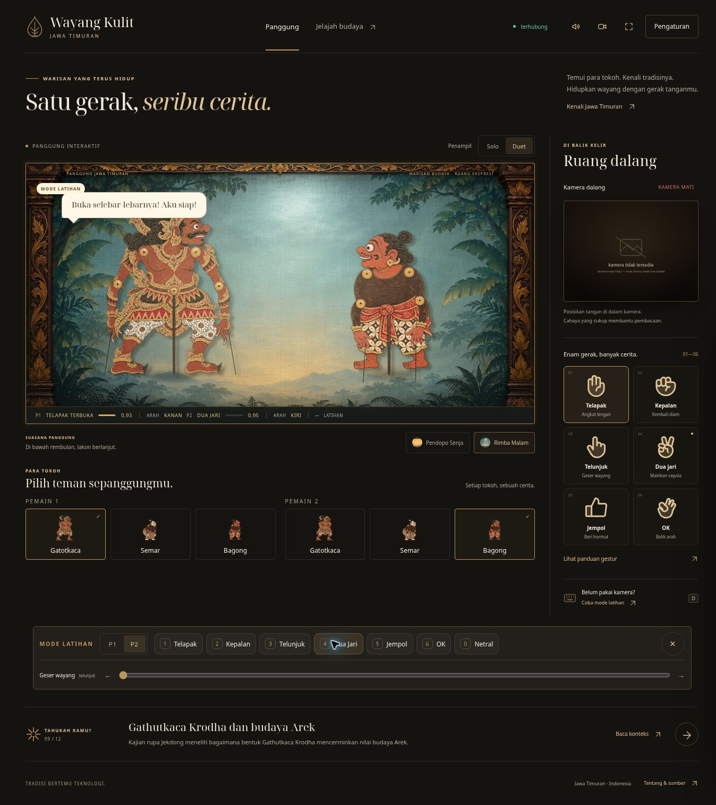

# Wayang Kulit Jawa Timuran

Panggung budaya interaktif berbasis webcam dan gestur tangan. Kenali tokoh, cengkok, musik, serta tradisi masyarakat Jawa Timuran, lalu mainkan wayang sendiri atau berduet.

Pengembangan versi 0.8.0 berada di branch `feat/jatim-stage-motion-v03`. [Rencana](docs/superpowers/plans/2026-11-18-wayang-kulit-jatim.md) · [Riset](docs/research/2026-11-18-wayang-kulit-jawa-timuran.md).

## Fitur

- Aksen SFX mengikuti persiapan, puncak dan pulihnya gerak tiap tokoh. Langkah hanya berbunyi saat wayang berpindah. P2 punya aksen sendiri, termasuk ketika membalas gestur yang sama.
- Bunyi yang terlalu berdekatan dibatasi; maksimum enam sumber SFX aktif dan kompresor SFX mengurangi lonjakan. Jeda, keluar lakon, ganti tokoh serta mute membatalkan bunyi aktif. Musik tetap memakai kanal independen.

- Lakon mini orisinal **Perkenalan di Kelir**: contoh otomatis sekitar 72 detik, tiga adegan, sembilan langkah. **Mainkan lakon** menunggu gestur P1; P2 memberi balasan bergantian. Jeda, ambil alih, lewati langkah, ulangi dan keluar tersedia di panel bawah panggung.
- Lakon menjaga jarak antartokoh dan menggunakan langkah yang lebih pelan. Mode bebas tetap dapat saling melintas. Saat keluar, jumlah pemain, sumber input, pemain latihan, posisi dan arah sebelumnya dipulihkan; pose kembali netral. Pilihan tokoh tidak diganti.
- Pergantian frase menyambung dari sudut sendi terakhir selama 240 ms; badan tetap kaku. Lakon dan gerak berhenti ketika tab disembunyikan atau panel modal dibuka. Menutup panel tidak membatalkan jeda manual.

- Dua latar ilustratif: Pendopo Senja dan Rimba Malam, dengan bingkai kayu, kelir bercahaya, dan lanskap berlapis. Pilihan suasana tersimpan di perangkat.
- Transisi pose berbasis spring yang konsisten terhadap frame rate; bahu, siku, dan badan bergerak berlapis, dengan ayunan susulan ketika berpindah.
- Telunjuk menggerakkan wayang sepanjang area aman panggung: posisi tangan 20–80% sudah mencapai rentang penuh. Contoh panggung desktop 944 px: sekitar ±277 px, menyesuaikan ukuran layar dan karakter.
- Tiga karakter berlapis: Gatotkaca, Semar, dan Bagong; satu atau dua pemain dengan pilihan tokoh masing-masing.
- Enam gestur tangan melalui MediaPipe dan model MLP; sumber kamera dapat diganti dari Pengaturan.
- Mode latihan dengan tombol, keyboard, dan slider posisi tangan untuk demo tanpa kamera.
- Panduan enam gestur dengan ikon duotone besar, keterangan aksi, dan indikator gestur aktif.
- Dua belas fakta budaya dengan kategori, konteks daerah, dan sumber penelitian. Konten tersedia lokal.
- Panel budaya menahan cue suara dan pintasan gestur saat dibaca; Escape menutup panel dan mengembalikan fokus.
- Tombol Audio dekat panggung: dialog, musik latar, dan SFX memiliki toggle serta volume terpisah; tersedia volume master dan Bisukan semua. Pilihan tersimpan di perangkat.
- Untuk pengunjung baru, BGM mulai pelan setelah panggung dibuka. Pilihan musik mati dari sesi sebelumnya tetap dihormati.
- Font dan aset lokal, tata letak ponsel, reduced motion, layar penuh, serta panel audio berbentuk bottom sheet di ponsel.



## Menjalankan di Windows

Pasang Python 3.10–3.12 terlebih dahulu. Dari PowerShell di folder proyek:

```powershell
.\setup.bat
.\run.bat
```

`setup.bat` membuat virtual environment dan memasang `requirements.txt`. Untuk pemakaian berikutnya cukup `run.bat`.

Buka **http://127.0.0.1:8000**. Kamera diakses oleh backend Python, bukan browser. Menjalankan frontend lewat `file://` tidak didukung.

## Linux/macOS atau setup manual

```bash
python3 -m venv .venv
source .venv/bin/activate
pip install -r requirements.txt
python -m backend.app
```

Di Windows, aktivasi manual menggunakan `.venv\Scripts\activate`. Internet diperlukan saat pemasangan paket; setelah dependensi lengkap, panggung dan konten lokal tidak memerlukan layanan eksternal. Membuka tautan sumber tetap memerlukan internet. Perangkat harus memiliki kamera dan memberikan izin yang diperlukan untuk deteksi nyata.

## Kendali

| Gestur | Tombol latihan | Perilaku |
| --- | --- | --- |
| Telapak terbuka | `1` | Menyapa dengan rangkaian lengan |
| Kepalan | `2` | Berhenti di posisi terakhir |
| Telunjuk | `3` | Berjalan mengikuti posisi tangan |
| Dua jari | `4` | Dua aksen siku dan lengan |
| Jempol | `5` | Membungkuk lalu kembali |
| OK | `6` | Berbalik arah |
| Netral | `0` | Kembali netral |

Gunakan pilihan **Pendopo Senja / Rimba Malam** di bawah panggung. Di mode latihan, geser slider **Geser wayang** untuk menguji telunjuk secara manual, atau tekan `3` untuk gerakan demo otomatis. Dalam duet, kedua tokoh berbagi panggung dan dapat saling melintas. Selama id tangan dari backend masih terlihat, pemilik P1/P2 tetap sama meskipun tangan menyilang. Lepaskan tangan dari kamera untuk melepas kepemilikan slot.

`D` membuka/menutup latihan, `P` memilih pemain latihan dalam mode Duet, `?` membuka panduan, `V` mengatur dialog, dan `K` mengatur kamera. Saat panel bacaan terbuka, pintasan gestur dinonaktifkan agar tidak mengganggu bacaan. Pilih **Coba tanpa kamera** untuk langsung membuka panggung dan latihan.

## Isi budaya dan aset

Cakupan materi adalah wayang kulit purwa gaya Jawa Timuran/Jekdong. Keterangan subgaya, naskah, dan dalang disertakan ketika suatu fakta hanya berlaku pada konteks tersebut. Tokoh tidak diklaim eksklusif milik satu daerah.

Ilustrasi dibuat baru sebagai interpretasi digital, dengan badan dan empat bagian lengan pada sprite sheet transparan. SVG runtime menyematkan raster WebP sekali dan memakai crop/pivot SVG untuk animasi; ini **bukan vektor murni**. Ilustrasi belum ditinjau praktisi pedalangan.

- [Kredit aset dan batas representasi](frontend/assets/jatim/ASSET_CREDITS.md)
- [Prompt, sumber produksi, dan metadata](frontend/assets/jatim/manifest.json)
- [Contact sheet pose](frontend/assets/jatim/rig-contact-sheet.webp)
- [Kredit audio](frontend/assets/audio/AUDIO_CREDITS.md)
- [Sumber fakta](frontend/data/culture.json)

Dialog Semar dan Bagong adalah naskah baru aplikasi. Suara memakai TTS perangkat; kualitas dan ketersediaan Bahasa Indonesia bergantung pada browser. Musik yang tersedia berasal dari beberapa tradisi; pengunjung baru mendengar BGM pelan setelah membuka panggung. Pilihan musik mati dari sesi sebelumnya tetap dihormati; kreditnya tersedia pada panel Audio. Efek gerak dan cue audio adalah interpretasi interaksi digital.

## Struktur

```text
backend/                 FastAPI, kamera, MediaPipe, model, pipeline, WebSocket
frontend/
  index.html             antarmuka panggung dan panel
  css/jawatimuran.css     tampilan Jawa Timuran di atas style/teater lama
  js/app.js              pemain, kamera, prediksi, pilihan karakter
  js/animation.js        rig, pivot, arah hadap, pergerakan
  js/culture-core.js     validasi konten dan pemilihan fakta tanpa pengulangan
  js/culture.js          kartu fakta, kategori, sumber, dan panel budaya
  js/theater*.js         babak pertunjukan, fokus panel, cue dan audio
  data/                  registry karakter dan fakta bersumber
  assets/jatim/          master, runtime, rig, kredit, dan metadata aset baru
  assets/fonts/          font lokal dan lisensi
  tools/                 pemeriksaan rig, perakitan SVG, dan tes frontend
shared/gesture_map.json   enam kelas gestur dan label aksi
models/                  MLP utama dan RF dalam pengaturan teknis
handoff_p2/              paket penelitian dan dataset landmark
```

Karakter dan berkas golek lama tetap menjadi arsip teknis; pilihan panggung versi ini menggunakan registry Jawa Timuran. Kontrak WebSocket `hands[]`, normalisasi 63 fitur, dan kelas model dipertahankan.

## Verifikasi

```bash
node --test frontend/tools/test_*.mjs
python frontend/tools/check_wayang_rig.py
python backend/tools/test_logika.py
python backend/tools/test_model_service.py
python backend/tools/test_kamera.py
python backend/tools/test_dua_tangan.py
python backend/tools/test_p2_model.py
```

Uji model menggunakan sampel dataset dan berbeda dari pengujian webcam langsung. Kamera nyata, pencahayaan ruang presentasi, serta suara Indonesia perlu diperiksa pada perangkat demo.

Untuk QA responsif lokal tambahan, `npm run dev` memakai Python dan dependensi yang sama; Node tidak diperlukan untuk menjalankan backend biasa. Fixture pada `/__qa/responsive-preview.html` hanya tersedia lewat entry point preview, bukan server aplikasi normal.

## Upgrade v0.3

Lihat [catatan riset dan keputusan gerak](docs/research/2026-11-18-upgrade-v03.md) dan [hasil verifikasi](docs/verification/2026-11-18-jatim-v03.json).

## Tahap 1 — audio v0.3.1

Tekan **Audio** di toolbar panggung. Matikan **Dialog wayang** untuk menyembunyikan bubble teks dan menghentikan ucapan, sambil tetap menikmati musik dan SFX. Toggle ketiga kanal saling independen; **Bisukan semua** mempertahankan pilihan masing-masing kanal ketika suara diaktifkan kembali. Pengaturan teknis juga mempunyai tautan ke panel Audio yang sama.

Volume master sekarang ikut mengatur rekaman dialog dan TTS browser. Pada beberapa browser, perubahan volume TTS saat sedang berbicara menghentikan kalimat tersebut; kalimat berikutnya memakai level baru. Rekaman dialog menyesuaikan volume saat itu juga.

Musik tetap dapat didengar selama panel Audio terbuka. Panel bacaan budaya masih menjeda panggung/audio. Panel audio menunjukkan status musik dan pesan jika berkas gagal dimuat. Sumber audio lama tetap digunakan dengan keterangan lintas tradisi; tahap ini tidak menambahkan rekaman baru atau klaim iringan Jekdong autentik.

[Verifikasi tahap 1](docs/verification/2026-11-18-audio-stage1.json)

## Tahap 2 — hierarki studio v0.3.2

Panggung kini mempunyai toolbar berisi **Solo/Duet**, **Audio**, **Latihan**, dan **Perbesar**. Latihan tampil langsung di bawah panggung, diikuti pilihan suasana dan tokoh. Tombol Latihan membuka panggung tanpa kamera dan menyinkronkan statusnya dengan pintasan `D` serta kontrol lain.

Ruang dalang dibagi menjadi kartu kamera dan panduan gestur yang dapat dilipat. Tombol kamera pada kartu memakai aksi yang sama dengan tombol kamera lama dan mencerminkan status aktivasi dari backend. Panduan mulai tertutup pada ponsel/tablet agar panggung lebih dekat ke atas halaman.

Pada layar kecil, toolbar menggunakan dua baris, tokoh duet ditumpuk per pemain, dan kamera/panduan mengikuti pilihan tokoh. Angka keyakinan, FPS, serta model tetap tersedia di Pengaturan; strip panggung berfokus pada gestur pemain. Mode Perbesar menyembunyikan panel pendamping, pilihan tokoh/suasana, dan fakta sambil mempertahankan kontrol bermain serta Audio. Jika fullscreen ditolak browser, mode fokus pada halaman tetap tersedia.

[Verifikasi tahap 2](docs/verification/2026-11-18-layout-stage2.json).


## Tahap 3–4 — fakta otomatis dan kendali v0.4.0

**Tahukah kamu?** berganti setiap 30 detik selama kartu terlihat. Gunakan tombol sebelumnya/berikutnya atau **Jeda / Putar**; pilihan jeda tersimpan di browser. Timer berhenti ketika kartu di luar layar, tab tidak aktif, panel modal terbuka, atau pointer/fokus keyboard sedang berada di kartu. Putar memulai waktu baca baru. Preferensi reduced motion memulai dalam mode manual kecuali pengguna sudah memilih otomatis.

Tinggi teks disiapkan untuk seluruh fakta agar pergantian tidak menggeser layout. Riwayat navigasi mempertahankan bacaan sebelumnya; fakta baru mengikuti siklus tanpa pengulangan. Pergantian otomatis tidak mengumumkan ulang teks melalui live region pembaca layar, sedangkan navigasi manual memakai pengumuman sopan.

Buka **Ruang dalang → Sesuaikan gerak**. Pilih kepekaan **Halus**, **Seimbang**, atau **Responsif**. Untuk kalibrasi, tunjukkan telunjuk di posisi tangan yang nyaman, lalu tekan **Kalibrasi titik tengah**. Dalam duet, pilih P1 atau P2 sebelum kalibrasi. Masing-masing pemain mempunyai titik tengah sendiri; kepekaan berlaku bersama. Pengaturan tersimpan lokal dan **Reset kendali** mengembalikan keduanya ke awal.

Kalibrasi juga dapat dicoba tanpa kamera: aktifkan **Latihan**, pilih pemain, lalu geser slider. Input kamera yang tidak terbaca selama lebih dari 1,5 detik tidak dapat dipakai untuk kalibrasi. Area tengah mempunyai toleransi kecil terhadap gerakan ringan, dan batas gerak panggung tetap dijaga agar wayang tidak keluar layar.

[Verifikasi tahap 3–4](docs/verification/2026-11-18-auto-controls.json). Kamera fisik dan kenyamanan gestur tetap perlu diuji pada perangkat presentasi.


## Upgrade v0.5.0 — dialog utuh dan rangkaian gerak

Toggle **Dialog wayang** kini mengatur ucapan sekaligus bubble teks. Ketika dimatikan, bubble yang sedang tampil langsung disembunyikan dan dialog tertunda dibatalkan. Menyalakannya kembali hanya menampilkan dialog baru. Musik dan SFX tetap mengikuti pengaturan masing-masing. Slider volume dialog hanya mengatur kerasnya ucapan; **Bisukan semua** tetap menjadi kontrol suara keseluruhan.

Animasi memakai rangkaian persiapan, aksen, tahan dan pulih, dengan tubuh wayang tetap kaku. Telapak menyapa, dua jari memainkan dua aksen lengan, jempol memberi hormat lalu pulih, dan OK membalik arah dengan angkatan singkat. Pada telunjuk, ayunan lengan serta angkatan mengikuti jarak dan kecepatan perpindahan. Kepalan/netral menghentikan wayang di posisi terakhir, tanpa kembali meluncur ke tengah.

Gatotkaca memakai tempo lebih tegas, Semar lebih lambat dan kecil, Bagong lebih cepat dan lebar. Preferensi reduced motion mempertahankan pose terbaca tanpa gerak langkah dan aksen berulang. Transisi CSS pada sendi tidak lagi menunda animasi pegas.

[Cuplikan dari browser](docs/images/jatim-v05-motion-preview.mp4) · [Rujukan dan batas interpretasi gerak](docs/research/2026-11-18-motion-v05.md) · [Verifikasi](docs/verification/2026-11-18-motion-dialog-v05.json)

Cuplikan disusun dari tangkapan browser dengan laju pengambilan terbatas dan tanpa audio; bukan pengukuran FPS aplikasi. Gerak ini belum ditinjau dalang dan tidak diklaim sebagai rekonstruksi motif sabet tradisional tertentu.


## Hotfix v0.5.1 — panggung tetap terbuka ketika jeda

Tirai tidak lagi menutup sebagian setelah 45 detik tanpa tangan. Indikator kecil **Menunggu gerakan tangan** menjelaskan jeda tanpa menutupi sisi panggung, termasuk ketika Dialog dimatikan. Tangan yang kembali terdeteksi membuka tirai penuh. Mengaktifkan Latihan melalui toolbar, tombol atau pintasan D membuka/melanjutkan panggung, termasuk dari istirahat. Penutupan penuh tetap berlaku pada pembukaan dan istirahat 90 detik.

[Rencana peningkatan berikutnya](docs/superpowers/plans/2026-11-18-roadmap-v06.md) memuat prioritas kendali, pertunjukan duet, iringan, pembelajaran, performa dan dukungan perangkat. Fitur lanjutan dalam dokumen tersebut belum diimplementasikan.


## Rilis fondasi v0.6.0 — kendali dan panduan mulai

Status dekat kamera membedakan kamera dimatikan, tidak tersedia, menunggu data, tangan belum terlihat, pose belum stabil, gestur diterima dan mode latihan. Kondisi model/pelacak yang belum siap juga mempunyai pesan tersendiri. Dalam duet, label per pemain menjelaskan tangan mana yang belum terlihat. Pembaca layar menerima status yang bertahan 700 ms, bukan pengumuman setiap frame; penundaan ini hanya untuk pengumuman, tidak menahan input wayang.

Jeda panggung kini mengikuti seluruh pemain: P2 keluar tidak menjedakan P1 yang masih terlihat. Tangan yang terlihat tetapi pose belum dikenali tetap dihitung hadir. Tangan yang kehilangan slot kembali netral setelah jeda lama yang sudah ada; slot lain tetap berjalan. Id tangan yang masih terlihat tidak berpindah tokoh karena menyeberang layar. Ketepatan id tetap bergantung pada tracker backend.

Tombol dan keyboard latihan dapat mengulang gestur yang sama. Frame kamera yang sama tetap tidak mengulang rangkaian; telunjuk terus menerima posisi tangan. Latihan juga tetap dimainkan tanpa pita peringatan koneksi ketika backend terputus; saat kembali ke kamera, status koneksi asli dipulihkan.

**Panduan mulai** memberi tiga langkah singkat, pintasan latihan dan pengaturan titik tengah. Tekan **Saya sudah paham** untuk menyimpannya dalam keadaan tertutup; panduan tetap dapat dibuka lagi. Panduan mulai dan panduan enam gestur tidak dibuka bersamaan agar panel bantuan lebih ringkas.

Aset JS/CSS memiliki penanda versi rilis untuk mencegah campuran kode lama dan baru setelah update. Hal ini tidak mengganti aturan cache kamera/health atau menambahkan filter klasifikasi. MLP, normalisasi 63 fitur dan kontrak `hands[]` tetap sama.

[Verifikasi v0.6.0](docs/verification/2026-11-18-controls-v06.json). Validasi input sintetik dan antarmuka sudah dilakukan; pengukuran latensi kamera ujung ke ujung, salah baca dan silang tangan pada webcam fisik belum dilakukan. Tahap berikutnya adalah audit gerak dan mode lakon mini/duet dari dokumen rencana.

## Memainkan lakon mini

1. Pilih tokoh dalam mode bebas, lalu tekan **Tonton contoh** atau **Mainkan lakon** di bawah panggung. Panggung otomatis menjadi duet. Kedua mode mulai dengan tombol latihan agar tetap dapat dicoba tanpa webcam.
2. Saat menonton, **Ambil alih P1** beralih ke mode main pada langkah yang sama. Saat bermain, ikuti instruksi satu per satu memakai tombol/angka 1–6; tombol **Latihan** atau D beralih kembali ke input webcam Python. Kamera HP belum didukung.
3. P2 membalas sekitar 1,6 detik setelah aksi diterima. Langkah berikutnya muncul setelah delapan detik; dalam mode main, langkah baru menunggu gestur yang sesuai tanpa batas waktu. **Lewati langkah** tersedia jika diperlukan.
4. **Keluar lakon** memulihkan konteks bermain sebelumnya. Jika aset masih dimuat, perintah keluar dicatat dan pemulihan dilakukan segera setelah pemuatan selesai. Tidak ada balasan otomatis yang dibawa ke mode bebas.

Instruksi adalah bagian kendali dan tetap muncul ketika Dialog mati; bubble dan suara dialog mengikuti toggle Dialog. Musik dan SFX tetap memakai pengaturan masing-masing. Lakon adalah cerita latihan orisinal dan interpretasi digital, bukan reproduksi pakem atau sabet yang sudah divalidasi dalang.

Catatan verifikasi: [rilis pertunjukan v0.7.0](docs/verification/2026-11-18-performance-v07.md). Aksen fase gerak ditambahkan pada v0.8.0; audit asal potongan/lisensi lanjutan dan uji webcam fisik masih terbuka.

## Iringan v0.8.0

Rangkaian aksen adalah interpretasi digital. BGM tetap mengalun bebas dan belum diklaim mengikuti ketukan karawitan. Menahan pose tidak mengulang rekaman pada setiap frame kamera. Reduced motion memakai satu aksen lembut untuk satu aksi; berjalan di tempat tidak menimbulkan ritme langkah.

[Verifikasi v0.8.0](docs/verification/2026-11-18-motion-audio-v08.md) · [Audit kredit audio](frontend/assets/audio/AUDIO_CREDITS.md). Halaman sumber dan pembuat telah ditelusuri, tetapi pencocokan potongan serta hak beberapa aset lama masih terbuka. Tidak ada audio baru dalam batch ini.
