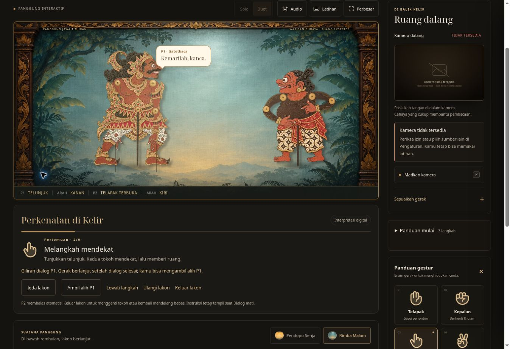

# Verifikasi sinkronisasi dialog v0.9.1

Tanggal: 18 November 2026. Branch: `feat/jatim-stage-motion-v03`.

## Hasil

- `npm test`: **200 lulus, 0 gagal**.
- `python frontend/tools/check_wayang_rig.py`: tujuh rig SVG lolos.
- `git diff --check`: bersih.
- QA browser: aplikasi produksi di preview, serta fixture yang mengganti transport suara dan kamera saja. Kode pengendali lakon, voice, theater, slot input dan rig tetap asli.

## Kasus regresi

| Kasus | Hasil |
| --- | --- |
| P1/P2 memiliki suara lebih panjang daripada durasi langkah lama | Kedua batas giliran menunggu penyelesaian suara; tidak melewatkan langkah |
| Rekaman gagal, error ganda, callback playing/ended lama | Hentikan rekaman sebelum fallback; callback usang tidak memengaruhi ucapan baru |
| Promise play ditolak setelah pembatalan sengaja | Tidak memulai TTS fallback dari ucapan yang sudah dibatalkan |
| TTS gagal sinkron, tidak start, tidak end | Kepemilikan dilepas; watchdog menghentikan jalur macet |
| Input gestur cepat | Teks terbaru langsung; hanya maksud terakhir yang stabil 280 ms disuarakan |
| Suara panjang melewati waktu baca | Bubble tetap terlihat sampai selesai |
| Stop/dialog off/master mute | Tidak membangkitkan suara tertunda; caption mute memakai waktu baca |
| Mode main | Kalimat orisinal lakon dengan karakter P1; pose tangan tambahan tidak membuat narasi baru |
| Jeda/modal/hidden bertumpuk | Jam lakon berhenti, kalimat terpotong diulang saat lanjut tanpa mengulang gerak |
| Skip/repeat/exit/takeover | Dialog dan callback sesi lama dibuang; jalur input lama tetap dipulihkan |

## Observasi browser

Simulasi suara **6 detik** dengan latensi awal **400 ms**. Waktu relatif dalam detik dari halaman uji:

| Kalimat | Mulai | Selesai | Giliran berikut diminta |
| --- | ---: | ---: | ---: |
| Mari meramaikan kelir! | 1,03 | 7,03 | 7,54 |
| Siap, aku menemanimu. | 7,94 | 13,94 | 14,64 |
| Kemarilah, kanca. | 15,04 | 21,04 | 21,54 |
| Aku mendekat pelan. | 21,94 | 27,94 | 28,64 |

Bubble yang tercatat saat start dan end sesuai kalimat. Kalimat “Sebentar, dengarkan.” dibatalkan saat jeda, lalu diminta ulang saat lanjut. Setelah keluar, rafal telapak/telunjuk/kepalan menghasilkan satu suara kepalan dengan bubble kepalan. Mode main kemudian menampilkan “Mari meramaikan kelir!”, bukan dialog gestur bebas, dan menunggu balasan P2.

Penghitung QA: **12 start, 0 overlap** pada rangkaian yang diamati. Ini bukan klaim pengukuran keluaran speaker fisik. [Log transport](evidence/v091-dialogue-browser-log.txt). Fixture terbuka melalui `/__qa/dialogue-preview.html` pada preview saja; tidak dimuat oleh index produksi.

## Batas

Webcam fisik dan kualitas speaker/TTS OS tidak tersedia untuk diuji. Browser dapat menolak suara atau tidak memiliki suara Indonesia; jalur gagal tetap memberi waktu baca dan tidak membekukan lakon. Latensi normal yang disengaja hanya berlaku untuk suara gestur (280 ms), sedangkan bubble langsung diperbarui. Rincian pilihan waktu ada di [riset teknis](../research/2026-11-18-dialogue-synchronization.md).
