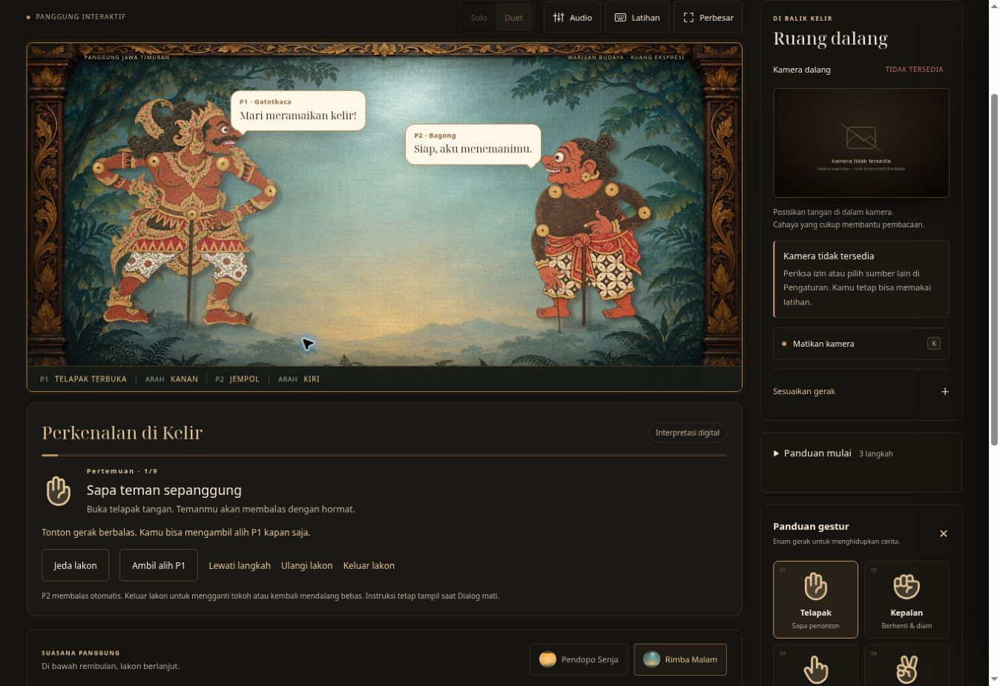
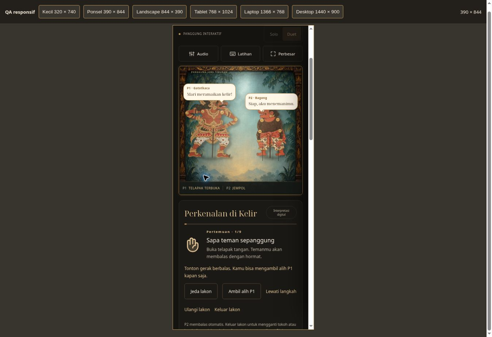

# Verifikasi lakon, input dan bubble v0.9.0

Tanggal: 18 November 2026. Branch: `feat/jatim-stage-motion-v03`. Basis: v0.8.0 (`f2dcb97`).

## Akar masalah

| Gejala | Penyebab | Perbaikan |
| --- | --- | --- |
| Main lakon terasa mematikan deteksi | `prepare()` selalu memanggil `Dummy.setActive(true)`; `onSocketMessage()` kemudian mengabaikan prediksi kamera. | Sumber input tidak diganti saat masuk lakon. Pilihan kamera/latihan sebelumnya dipertahankan. |
| Satu tangan kanan tidak menggerakkan P1 | Lakon menggunakan allocator duet: tangan kanan dialokasikan ke P2, sedangkan input manual P2 diblokir. | Allocator satu tangan khusus P1 terpandu, independen dari allocator duet bebas. ID tangan yang sudah memegang P1 tetap dipertahankan. |
| Keluar tidak pulih konsisten | Jalur sumber, kepemilikan slot dan deduplikasi teater dapat tertinggal antar mode; callback sumber berjalan saat sesi masih dikunci. | Reset slot/label/presence saat sesi atau sumber berganti; sinkronisasi status koneksi setelah penguncian sesi dilepas, termasuk koneksi putus. |
| Bubble kanan hilang | Teater menduplikasi nama gestur secara global, memakai satu bubble/timer, dan menolak caption ketika suara sebelumnya sibuk. | Deduplikasi per pemain, dua node/timer/pending caption; P2 tetap muncul saat P1 berbicara. Ucapan baru menggantikan ucapan lama, tanpa antrean suara terlambat. |
| Bubble terpasang di pojok tetap | Posisi memakai sisi panggung, bukan transform tokoh. | Koordinat kepala rig ditransformasikan dengan `getScreenCTM`; posisi mengikuti travel, bungkuk, mirror/facing, resize dan fullscreen. Layout menjaga batas panggung dan memisahkan caption yang berdekatan. |

`Dummy.setActive(saved.practice)` saat keluar memulihkan pilihan eksplisit pengguna pada awal sesi. Jika memang masuk dari latihan, keluar tetap latihan. Sumber tersebut sekarang diterangkan pada instruksi main; tidak ada lagi perpindahan otomatis tersembunyi ke latihan.

## Pertunjukan dan tampilan

- Mode tonton **35 detik waktu aktif**, sembilan langkah dalam tiga adegan. Sebelumnya 72 detik. Balasan dimulai sekitar 0,65–1,1 detik dan pergantian langkah 2,8–4,8 detik.
- 18 aksi utama/balasan ditambah 15 aksen khusus menonton: variasi sapaan, aksen lengan, berhenti, hormat dan putar. Aksen tambahan dibuang ketika ambil alih/lewati/ulang/keluar; mode main tetap menunggu input P1.
- Naskah pendek orisinal per giliran, sekitar satu kalimat pendek. Aksen kecil tidak menambah dialog acak yang menumpuk.
- Bubble ivory lebih ringkas, ukuran teks 11–14 px, label P1/P2 dan nama tokoh, ekor penunjuk, batas lebar yang menyesuaikan layar. Dua bubble tidak saling menimpa pada susunan yang diuji.
- Dialog mati menyembunyikan kedua bubble dan ucapan; instruksi lakon, musik dan SFX tetap independen.
- Backend, model MLP, 63 fitur landmark dan protokol prediksi tidak diubah.

## Pengujian otomatis

`npm test`: **186/186 lulus**.

Regresi baru menghubungkan **pengendali lakon asli + adapter aplikasi asli + allocator asli + handler WebSocket asli** dalam VM, dengan DOM/render/transport diganti fixture. Tes membuktikan sumber tetap live selama main/tonton, tangan kanan masuk P1, identitas P1 tidak direbut tangan baru, label yang sama diterima lagi setelah keluar, pilihan latihan eksplisit pulih, serta pita/status koneksi putus disinkronkan saat keluar.

Tes lain mencakup caption kanan saat suara kiri sibuk, timer tertunda independen, Dialog mati untuk keduanya, deduplikasi per pemain, cerita 35 detik, aksen watch-only, pembatalan saat ambil alih, serta geometri bubble di kedua arah dan tepi pada lebar 280–1920 piksel.

Pemeriksaan tambahan: sintaks JavaScript, kontrak tujuh rig dan `git diff --check`.

## Uji browser

Server preview terkelola dengan aplikasi utama dan halaman QA terpisah. `/__qa/lakon-input-preview.html` memuat HTML aplikasi asli dan fixture WebSocket/fetch khusus preview. Tombol fixture mengirim paket `hands[]` berkala melalui event `message` WebSocket; tidak memanggil handler aplikasi atau API lakon tersembunyi secara langsung. Semua kontrol fixture berlabel **simulasi transport, bukan webcam fisik**. Fixture tidak dimuat oleh `frontend/index.html` produksi.

| Alur | Hasil teramati |
| --- | --- |
| Mainkan lakon, tangan id77 pada `wrist_x=.85`, telapak | P1 menerima Telapak Terbuka; status “Gestur diterima — beri waktu P2 untuk membalas”, Latihan tetap mati. |
| Keluar main, ubah tangan menjadi Dua Jari | Strip P1 berubah menjadi DUA JARI. |
| Tonton → keluar → tangan kanan Kepalan | Strip P1 berubah menjadi KEPALAN; tidak memerlukan toggle latihan atau reload. |
| Tonton pada aplikasi utama dengan Dialog nyala | Bubble P1 “Mari meramaikan kelir!” dan P2 “Siap, aku menemanimu.” tampil bersamaan, dengan label tokoh masing-masing. |
| Kamera simulasi: Telunjuk kanan → Telunjuk kiri, tanpa mengganti kelas | Bubble dengan teks yang sama bergerak dari x≈791 ke x≈294; slot wayang ikut bergeser. Ini koordinat viewport uji, bukan nilai posisi tetap dalam aplikasi. |
| Mode tonton sampai SELESAI | Lakon menutup, tombol jeda/lewati nonaktif dan ulang/keluar tetap tersedia. |
| Dialog mati saat tonton | Kedua node bubble tetap `hidden=true`. Setelah dinyalakan dan sesi diulang, keduanya tampil lagi. |
| Lebar 390 × 844 | Dua bubble di dalam panggung, tidak bertumpuk. |
| Lebar 320 × 740 | `clientWidth=305`, `scrollWidth=305`; kedua bubble sekitar 115,5 × 62 px dan tidak bertumpuk. |
| Console aplikasi utama | Tidak ada error/warning aplikasi pada rangkaian akhir yang diperiksa. |

## Batas verifikasi

Tidak ada webcam fisik di lingkungan ini. Keberhasilan handler dan transport simulasi tidak dianggap sebagai uji MediaPipe/MLP dengan tangan nyata, pencahayaan atau driver kamera pengguna. Pemeriksaan tersebut tetap diperlukan di perangkat pengguna.

35 detik adalah waktu aktif tanpa jeda; mode main dapat lebih lama karena menunggu pengguna. Perubahan durasi ini mengikuti permintaan mempercepat pergantian gerak dan menggantikan target 60–90 detik dalam roadmap awal. Gerak/naskah merupakan interpretasi digital, bukan pakem yang telah ditinjau dalang. Tinjauan praktisi dan audit lisensi aset yang tersisa tetap di luar batch ini.
