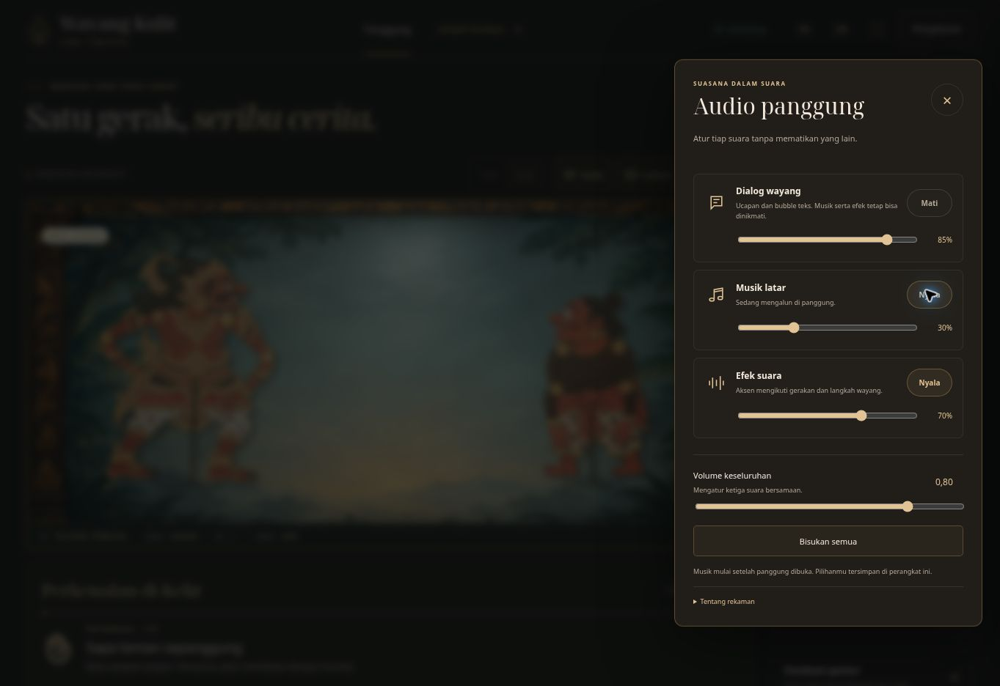
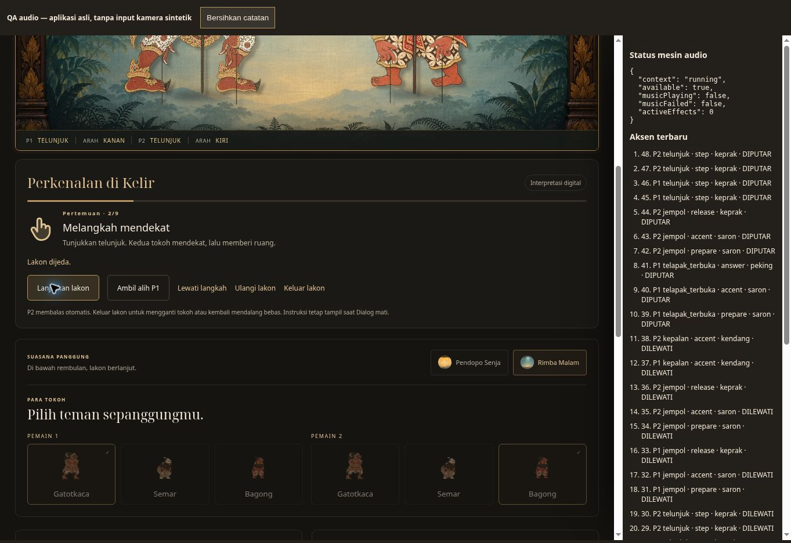

# Verifikasi iringan v0.8.0

Tanggal: 18 November 2026. Branch: `feat/jatim-stage-motion-v03`. Dasar: v0.7.0 (`59d4c08`).

## Temuan dan hasil perubahan

1. Cue teater mengirim `telapak_terbuka`, sedangkan audio lama hanya mengenali `telapak`. Alias diperbaiki. Di aplikasi utama, bunyi gestur kini mengikuti event dari clock animasi; cue pembuka/istirahat tetap lewat teater.
2. Cooldown teater global 2,5 detik dan deduplikasi nama global dapat menutup bunyi balasan P2. Marker setiap pemain kini independen, sementara playback membatasi onset yang terlalu rapat selama 120 ms. Dialog/lampu tetap mengikuti kebijakan teater yang sudah ada.
3. Sapaan: persiapan dan dua aksen; dua jari: dua aksen; hormat: persiapan, puncak dan pulih; putar: whoosh persiapan dan aksen; berhenti: satu kendang ringan. Waktu memakai tempo profil tokoh. Ini keputusan koreografi digital, bukan transkripsi iringan tradisional.
4. Telunjuk memakai akumulasi jarak gait, bukan interval waktu. Diam tidak menghasilkan bunyi langkah. Reduced motion mendapatkan satu aksen lembut untuk satu frase, tanpa ritme langkah.
5. Anggaran SFX paling banyak enam sumber terdaftar, gain aksen dibatasi dan berganti sedikit, serta kompresor terpisah pada bus SFX. Sumber yang dibatalkan memakai release 12 ms lalu stop 15 ms; pelepasan singkat itu dapat sesaat beririsan dengan sumber baru. Ini mengurangi penumpukan/klik, bukan sertifikasi bebas clipping pada semua perangkat.
6. Jeda, keluar/ulang lakon, modal, tab tersembunyi, ganti tokoh dan mute membatalkan sumber SFX terkait. Tidak ada antrean hit yang diputar terlambat setelah berkas selesai dimuat. Volume nol juga membuang ekor SFX; mengembalikan volume tidak menghidupkan bunyi lama.
7. BGM, SFX dan Dialog tetap terpisah; ducking musik tetap mengikuti ucapan. Kacapi arsip yang tidak dipakai tidak lagi dipramuat. Tidak ada aset biner audio yang diganti.

## Hasil otomatis

`npm test`: **174/174 lulus**. Termasuk penanda tiap tokoh pada 30/60/120 fps, pose ditahan, interupsi/ulang, langkah diam/bergerak, reduced motion, duet identik, anggaran onset, batas sumber, penghentian hit terjadwal, volume/mute, routing kompresor serta wiring teater asli dengan Dialog mati.

Pemeriksaan tambahan: sintaks JavaScript, `git diff --check`, kecocokan inventaris SHA-256 dengan sebelas aset non-dialog lokal, dan kontrak tujuh rig SVG. Status akhir dicatat setelah pemeriksaan dijalankan.

## Integrasi browser

Uji melalui `/__qa/audio-preview.html`, yang menyematkan aplikasi asli dan menampilkan event aksen serta status WebAudio. Tidak mengirim prediksi kamera sintetik dan tidak memanggil API tersembunyi lewat console. Angka DIPUTAR berarti WebAudio berhasil membuat/memulai sumber, bukan konfirmasi suara speaker fisik.

| Skenario | Hasil teramati |
| --- | --- |
| Contoh lakon P1 Gatotkaca/P2 Bagong, Dialog mati | Persiapan/puncak/balasan P1 dan P2 tercatat DIPUTAR; BGM `musicPlaying=true`. |
| Sapaan berbalas identik dan dua jari | Kedua pemain mendapat aksen sendiri, tidak tertahan cooldown 2,5 detik teater. |
| Telunjuk mendekat | Keprak langkah tercatat untuk P1 dan P2 saat berpindah. |
| Jeda manual | Catatan tetap 22 event selama menunggu; `activeEffects=0`, musik tetap berjalan. |
| Jeda → Audio → tutup Audio | Jeda manual tetap aktif. Tidak ada aksen baru sampai dilanjutkan. |
| SFX mati, Musik nyala | Event berikutnya DILEWATI; `musicPlaying=true`; lakon sampai SELESAI. |
| Musik mati, SFX nyala → ulang lakon | Aksen P1/P2 kembali DIPUTAR; `musicPlaying=false`. |
| Final aplikasi utama | Script berversi v0.8.0 dimuat, Dialog mati/SFX nyala/Musik nyala dapat dipilih terpisah. Tidak ada error/warning aplikasi pada console yang diperiksa. |

Cuplikan [trace DOM](2026-11-18-audio-browser-trace.json) menyimpan 35 entri terakhir, bukan seluruh sejarah sesi. Gambar di bawah menunjukkan keadaan uji, bukan hasil pengukuran kenyaringan.

## Audit asal audio

[Kredit audio](../../frontend/assets/audio/AUDIO_CREDITS.md) kini mencantumkan halaman primer, pembuat dan lisensi sumber yang ditemukan; [inventaris](../../frontend/assets/audio/AUDIO_INVENTORY.json) mencatat durasi, ukuran dan SHA-256 lokal. Metadata musik panggung menyebut RTB45; empat sumber WAV koleksi Bandung menyebut Salomo Christian Hutajulu. Halaman gender 1931 mendeskripsikan musik Bali, sehingga label lintas tradisi tetap dipertahankan.

**Batas audit:** metadata bukan bukti bahwa waveform potongan lokal berasal dari kandidat tersebut. Unduhan rekaman RTB45 melalui URL halaman berkas dan original mendapat HTTP 403; tidak ada sumber baru yang berhasil diperoleh. Titik potong/build lama, sumber gong persis, hak arsip/TTS dan kecocokan rekaman masih terbuka. Oleh karena itu gerbang “semua aset telah diverifikasi izinnya” pada tahap 3 belum ditandai selesai. Tidak ada klaim iringan khusus Jekdong atau sinkronisasi BPM dengan musik latar.

Uji speaker, pengukuran latensi audiovisual perangkat fisik, tinjauan praktisi, serta audit seluruh kombinasi gerak/tokoh tetap diperlukan. Tahap pembelajaran berikutnya belum termasuk batch ini.
