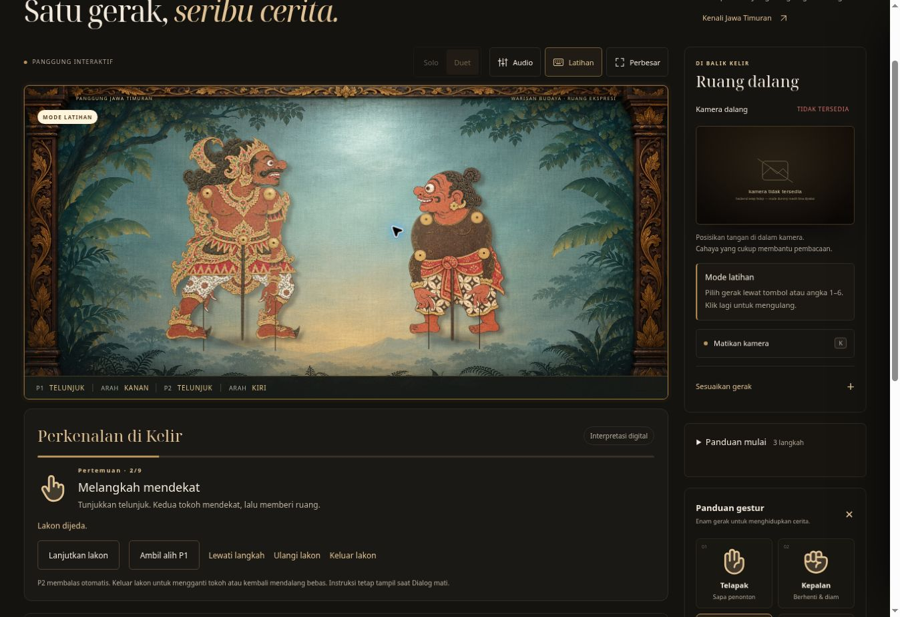
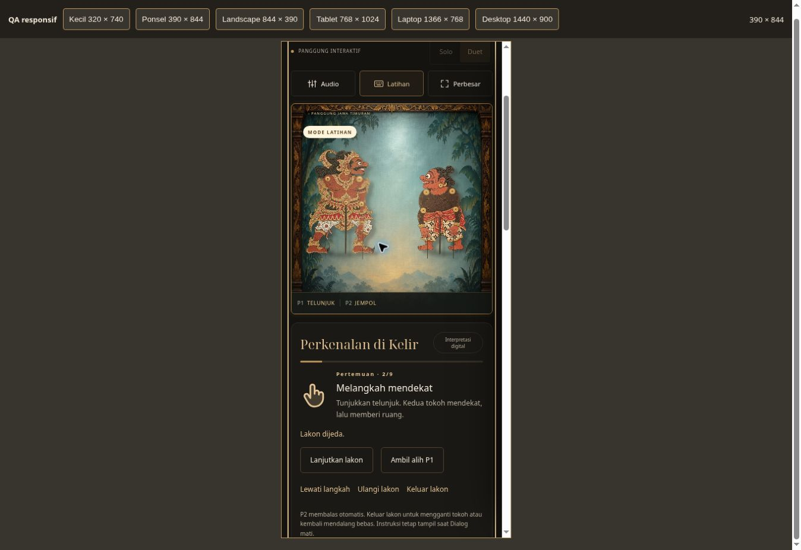

# Verifikasi pertunjukan v0.7.0

Tanggal: 18 November 2026. Branch: `feat/jatim-stage-motion-v03`. Dasar: v0.6.0 (`63c1b67`).

## Perubahan yang diperiksa

- Lakon latihan orisinal **Perkenalan di Kelir**, sembilan langkah dalam tiga adegan. Contoh otomatis memiliki 72 detik waktu aktif; main terpandu menunggu gestur P1 tanpa batas waktu. Balasan P2 terjadi sekali per langkah, sekitar 1,6 detik setelah aksi.
- Mode lakon menjaga jarak dan menggunakan spring perpindahan lebih lambat. Pengaturan kalibrasi kamera tidak menentukan koordinat koreografi. Mode bebas tetap bisa melintas.
- Pergantian frase mengambil sudut bahu/siku, kemiringan badan dan tinggi terakhir sebagai awal, lalu menyambung selama 240 ms. Profil tempo/amplitudo Gatotkaca, Semar dan Bagong tetap digunakan; reduced motion tetap memakai pose terbatas.
- Keluar lakon menghapus respons tertunda, batas jalur dan target otomatis; mengembalikan jumlah pemain, sumber input, pemain latihan, posisi dan arah. Pose pulih netral. Tokoh tidak diganti.
- Jeda manual, tab tersembunyi, dan modal menahan waktu lakon serta rig. Menutup modal tidak melepaskan jeda manual. Perintah keluar saat aset dimuat dicatat; pemulihan berlangsung setelah pemuatan selesai, tanpa menjalankan koreografi terlambat.
- Instruksi tidak memakai bubble; toggle Dialog tetap menyembunyikan bubble dan ucapan. Musik/SFX mengikuti preferensi independen yang sudah ada. Tidak ada aset audio baru dalam batch ini.

## Hasil otomatis

`npm test`: **157/157 lulus**. Tambahan mencakup durasi/akhir lakon, satu balasan per langkah, gestur salah/P2, tunggu tanpa timeout, ambil alih, lewati, ulang, keluar saat memuat, kegagalan aset, jeda bertumpuk, pemulihan konteks, batas jalur dan sambungan pose. Handler input aplikasi asli juga diuji: kamera/latihan tidak menimpa contoh atau P2 otomatis; timer tangan hilang tidak terbawa ke lakon.

`python3 frontend/tools/check_wayang_rig.py`: tujuh rig lulus, termasuk ketiga tokoh Jawa Timuran. `git diff --check`: lulus.

## Uji integrasi browser

Pratinjau aplikasi asli melalui server preview terkelola. Tidak ada webcam fisik pada lingkungan ini.

| Alur | Hasil |
| --- | --- |
| Tonton contoh dari awal hingga SELESAI | Lulus; sembilan langkah selesai, tombol jeda/lewati menjadi nonaktif. |
| Ulangi dan ambil alih pada langkah aktif | Lulus; mode main menunggu aksi P1. |
| Tombol Telapak/Telunjuk, balasan P2, lewati langkah | Lulus; status diterima muncul dan instruksi berganti. |
| Jeda manual → Audio → tutup Audio | Lulus; babak, progres dan transform rig tetap sama. |
| Dialog mati dengan Musik/SFX aktif | Bubble tetap tersembunyi; instruksi lakon tetap terlihat. Pemutaran suara fisik tidak diukur. |
| Keluar → Solo/kamera semula | Lulus; penguncian tokoh dan mode dilepas. |
| Duet/latihan/P2 → lakon → keluar | Lulus; pemilih latihan kembali ke P2 (`aria-pressed=true`). |
| Ganti tokoh menjadi Semar, balik arah, sapaan bebas | Lulus pada pemeriksaan singkat; bukan audit rekaman seluruh kombinasi. |
| Perbesar → keluar layar penuh → jeda | Lulus; panel/kontrol lakon tetap dapat dijangkau lewat gulir. |
| Console aplikasi setelah rangkaian akhir | Tidak ada error/warning aplikasi; log ekstensi browser dikecualikan. |

### Ukuran layar

Preset adalah ukuran iframe CSS; lebar dokumen sedikit lebih kecil karena scrollbar. Tidak ada overflow horizontal pada sesi lakon yang dijeda.

| Preset | clientWidth | scrollWidth |
| --- | ---: | ---: |
| 320 × 740 | 305 | 305 |
| 390 × 844 | 375 | 375 |
| 844 × 390 | 829 | 829 |
| 768 × 1024 | 753 | 753 |
| 1366 × 768 | 1351 | 1351 |
| 1440 × 900 | 1425 | 1425 |

## Batas dan pekerjaan berikutnya

- Cerita/gerak merupakan interpretasi digital. Belum ada tinjauan dalang, validasi pakem sabet, atau rekaman penilaian lengkap 3 tokoh × 6 aksi × 2 arah × tengah/tepi pada desktop/mobile. Pemeriksaan rig, batas numerik dan spot check browser tidak menggantikan audit itu.
- Latensi/salah baca/crossing webcam fisik, dukungan kamera HP, profil FPS/memori perangkat dan zoom 125/150% belum diverifikasi.
- Cue SFX berdasarkan fase gerak, audit rekaman/lisensi lanjutan serta tahap pembelajaran masih di roadmap. Musik saat ini tidak diklaim sinkron dengan tempo koreografi.
- Durasi 72 detik adalah waktu aktif; jeda/tab tersembunyi/modal memperpanjang waktu dinding. Mode main dapat lebih lama karena menunggu pengguna.
- Posisi pulih berdasarkan koordinat panggung yang dinormalisasi dan dibatasi ulang jika layar berubah. Pada layar yang sangat sempit, jalur dapat menyusut; fallback mencegah batas terbalik, bukan jaminan jarak fisik untuk ukuran tokoh yang mustahil dimuat.
